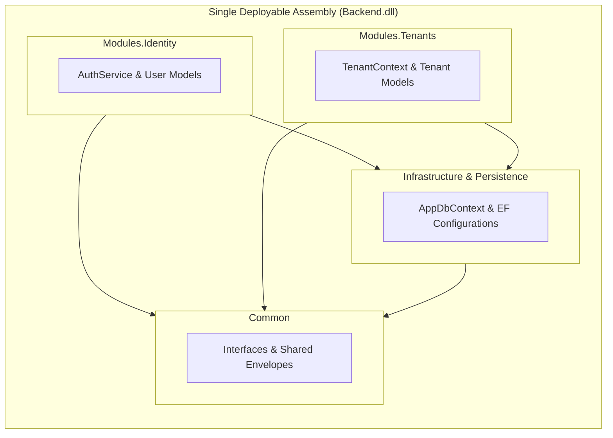

# 01. Modular Monolith Architecture & Design Patterns

## Overview & Architectural Vision

**ResilienceX** is structured as a **Modular Monolith**. This architectural style combines the logical boundaries, autonomy, and encapsulation of microservices with the deployment simplicity, operational efficiency, and transactional guarantees of a monolithic runtime.

---

## 1. Monolithic Deployment vs. Modular Design

In enterprise logistics and supply chain software, microservices are frequently introduced prematurely, leading to distributed transaction failures, network latency, distributed logging complexities, and high DevOps maintenance overhead. 

ResilienceX avoids premature distribution while enforcing strict boundaries inside a single deployable assembly:



### Key Architectural Advantages
1. **In-Process Communication**: Communication between modules is executed via standard C# interface invocations and direct method calls without network hops, JSON serialization overhead, or distributed failure modes.
2. **Atomic Transactions**: Complex cross-entity operations can participate in atomic database transactions (`BeginTransactionAsync`) when required.
3. **Single Build & Pipeline**: A unified CI/CD pipeline builds `Backend.csproj` into a single container or binary.
4. **Future Extraction Ready**: Modules maintain clean folder boundaries and do not share internal private states, allowing any module (e.g. `Shipments` or `Telematics`) to be extracted into an independent microservice in the future if scale warrants.

---

## 2. Clean Separation of Concerns

The solution enforces a four-tier layer of responsibility:

| Layer | Location | Primary Responsibilities |
| :--- | :--- | :--- |
| **API / Presentation** | `Controllers/` | HTTP transport, request routing, HTTP status codes, parameter binding, and OpenAPI documentation attributes. |
| **Domain Modules** | `Modules/{Name}/` | Business entities, validation rules, application use cases, domain services, and repository interfaces. |
| **Infrastructure** | `Infrastructure/` | Concrete database access (`AppDbContext`), EF Core mapping configurations, cryptographic tokens, background workers. |
| **Common / Cross-Cutting** | `Common/` | Shared response envelopes (`ResponseDTO<T>`), marker interfaces (`ITenantEntity`), constants, and global utility helpers. |

---

## 3. Core Architectural Patterns

### A. The Repository Pattern
The repository pattern abstracts direct database querying behind clean, domain-specific interfaces:

* **Interface**: [IUserRepository.cs](file:///c:/Users/DELL/Downloads/UPS_Project/Backend/Backend/Modules/Identity/Interfaces/IUserRepository.cs)
  ```csharp
  public interface IUserRepository
  {
      Task<User?> GetByEmailAsync(string email, CancellationToken cancellationToken = default);
      Task<bool> EmailExistsAsync(string email, CancellationToken cancellationToken = default);
      Task<User> AddAsync(User user, CancellationToken cancellationToken = default);
  }
  ```
* **Implementation**: [UserRepository.cs](file:///c:/Users/DELL/Downloads/UPS_Project/Backend/Backend/Modules/Identity/Repositories/UserRepository.cs)
  * Uses EF Core `AppDbContext` internally.
  * Encapsulates Linq queries (`FirstOrDefaultAsync`, `AnyAsync`).
  * Prevents EF Core querying logic from leaking into business services or API controllers.

### B. The Service Pattern
Domain services orchestrate complex business flows, cryptographic operations, and coordinate multiple repositories:

* **Interface**: [IAuthService.cs](file:///c:/Users/DELL/Downloads/UPS_Project/Backend/Backend/Modules/Identity/Interfaces/IAuthService.cs)
  ```csharp
  public interface IAuthService
  {
      Task<User?> RegisterAsync(RegisterDTO registerDto, CancellationToken cancellationToken = default);
      Task<(User User, string Token)?> LoginAsync(LoginDTO loginDto, CancellationToken cancellationToken = default);
      Task<(User User, string Token)?> LoginWithGoogleAsync(string credential, CancellationToken cancellationToken = default);
  }
  ```
* **Implementation**: [AuthService.cs](file:///c:/Users/DELL/Downloads/UPS_Project/Backend/Backend/Modules/Identity/Services/AuthService.cs)
  * Enforces business rules: email uniqueness verification, password hashing, tenant provisioning, and JWT creation.

### C. Dependency Injection (DI)
All dependencies are inverted and registered in the composition root (`Program.cs`) using standard ASP.NET Core service lifetimes:

```csharp
// Infrastructure & Persistence
builder.Services.AddDbContext<AppDbContext>(...);

// Tenant Resolution (Scoped: 1 instance per HTTP request)
builder.Services.AddHttpContextAccessor();
builder.Services.AddScoped<ITenantContext, TenantContext>();
builder.Services.AddScoped<ITenantRepository, TenantRepository>();

// Identity Module (Scoped)
builder.Services.AddScoped<IUserRepository, UserRepository>();
builder.Services.AddScoped<IAuthService, AuthService>();
builder.Services.AddScoped<IPasswordHasher<User>, PasswordHasher<User>>();
```

#### Lifetime Breakdown:
* **`Scoped`**: Used for `AppDbContext`, `UserRepository`, `TenantRepository`, `AuthService`, and `TenantContext`. Ensures all operations within a single HTTP request share the same Unit of Work and ambient tenant context, while completely isolating concurrent HTTP requests.
* **`Singleton`**: Used for stateless services such as `IPasswordHasher<User>`.

### D. Data Transfer Object (DTO) Pattern
Domain entities (`User`, `Tenant`) are never exposed directly to client applications over the network. 

1. **Information Protection**: Exposing domain entities directly risks over-posting attacks, circular serialization references, and leaking confidential fields (such as `PasswordHash`).
2. **API Stability**: DTOs decouple internal database schema changes from public API contracts consumed by the React client.

### E. Standard Response Envelope (`ResponseDTO<T>`)
All endpoints return an immutable response envelope defined in [Common/Responses/ResponseDTO.cs](file:///c:/Users/DELL/Downloads/UPS_Project/Backend/Backend/Common/Responses/ResponseDTO.cs):

```csharp
namespace Backend.Common.Responses
{
    public class ResponseDTO<T>
    {
        public bool Success { get; set; }
        public string Message { get; set; } = string.Empty;
        public T? Data { get; set; }
    }
}
```

This guarantees uniform error handling and response parsing across the entire frontend application.

---

## 4. Key Primitives: `Guid` vs. `int`

A deliberate architectural decision was made regarding identity types:

* **Users (`int Id`)**: Maintains sequential integer primary keys for low-level internal user indexing.
* **Tenants (`Guid Id`)**: Uses globally unique 128-bit identifiers (`Guid.NewGuid()`).

### Why `Guid` for Tenants?
1. **Anti-Enumeration & Security**: Sequential integer IDs (e.g. `TenantId=1`, `TenantId=2`) allow attackers to infer total customer count and attempt sequential ID enumeration attacks. Non-sequential UUIDs/GUIDs prevent brute-force attacks across organization boundaries.
2. **Distributed & Multi-Region Generation**: GUIDs can be generated safely in application code without a database round-trip or centralized sequence generator.
3. **Enterprise Integration**: 3PL carriers and corporate clients can synchronize records across disparate systems without primary key collisions.
