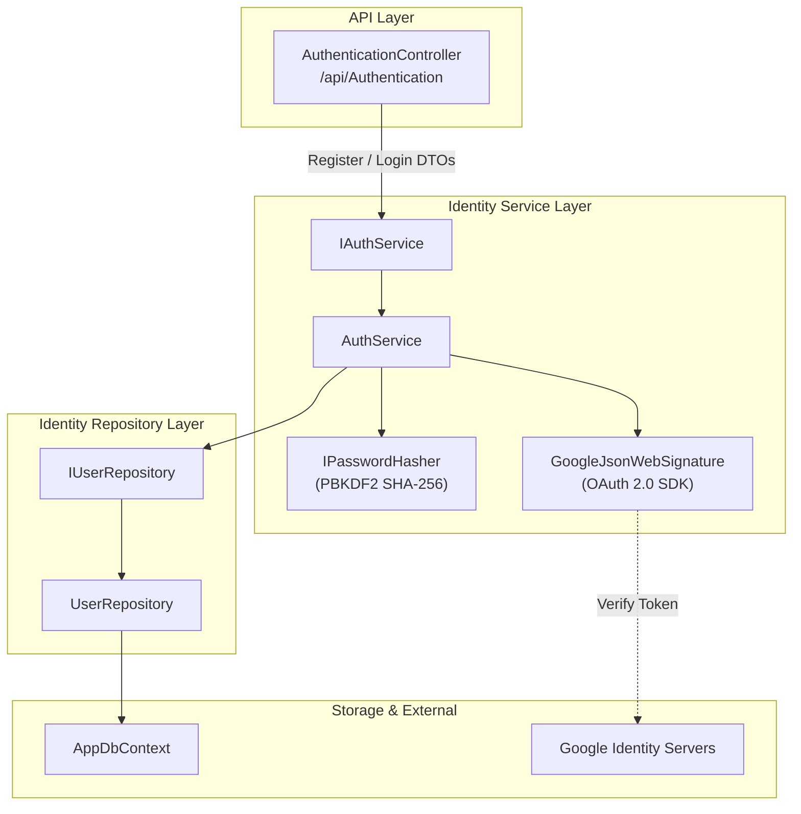
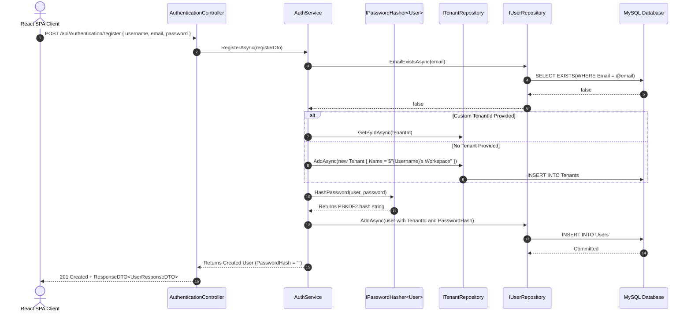
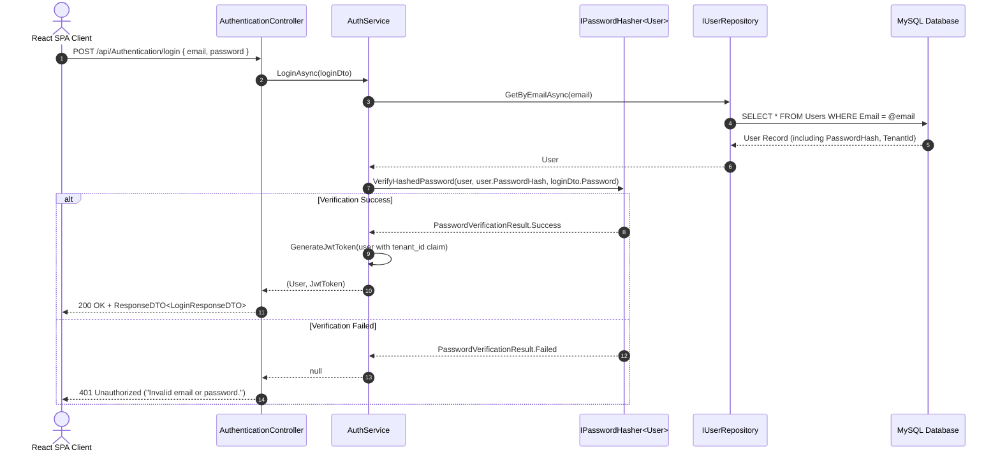

# 02. Identity Module

## Objective & Purpose

The **Identity Module** (`Modules/Identity`) encapsulates all domain entities, validation rules, cryptographic operations, and persistence flows related to user identification, authentication, and role preparation in ResilienceX.

It replaces the previous flat file structure with an autonomous modular boundary, ensuring that identity logic is completely decoupled from future operational logistics modules (such as Shipments, Incidents, or Continuity).

---

## Architecture & Design Decisions



### Key Design Decisions
1. **PBKDF2 Cryptographic Password Hashing**: Utilizes ASP.NET Core's production-grade `IPasswordHasher<User>` implementing PBKDF2 with HMAC-SHA256, automatic salting (128-bit per-user cryptographically random salt), and 100,000+ key derivation iterations.
2. **Dual-Provider Authentication**: Supports native credential logins alongside Google OAuth 2.0 ID Token verification.
3. **Information Scrubbing**: Domain entities sanitized before leaving service boundaries (e.g., `createdUser.PasswordHash = string.Empty`).
4. **Tenant-Aware Registration**: Automatically establishes a dedicated tenant workspace for self-registered and Google users, or joins an existing tenant via `TenantId`.

---

## Components & Responsibilities

### 1. Domain Entities
* **[User.cs](file:///c:/Users/DELL/Downloads/UPS_Project/Backend/Backend/Modules/Identity/Models/User.cs)**:
  ```csharp
  namespace Backend.Modules.Identity.Models
  {
      public class User : ITenantEntity
      {
          [Key]
          public int Id { get; set; }

          [Required]
          [MaxLength(50)]
          public string Username { get; set; } = string.Empty;

          [Required]
          [EmailAddress]
          [MaxLength(254)]
          public string Email { get; set; } = string.Empty;

          [Required]
          public string PasswordHash { get; set; } = string.Empty;

          [Required]
          public Guid TenantId { get; set; }

          public Tenant? Tenant { get; set; }
      }
  }
  ```
  * Implements `ITenantEntity` so queries and mutations automatically honor tenant scoping.
  * Encapsulates credentials, tenant linkage, and user metadata.

### 2. Data Transfer Objects (DTOs)
Located in [Modules/Identity/DTOs/](file:///c:/Users/DELL/Downloads/UPS_Project/Backend/Backend/Modules/Identity/DTOs/):
* `RegisterDTO`: Inbound registration payload containing `Username`, `Email`, `Password`, and optional `TenantName` / `TenantId`.
* `LoginDTO`: Inbound credentials containing `Email` and `Password`.
* `GoogleLoginDTO`: Inbound Google One-Tap / OAuth credential token string.
* `LoginResponseDTO`: Outbound authentication payload containing `Token` (JWT string), `Username`, and `Email`.
* `UserResponseDTO`: Sanitized user metadata representation (`Id`, `Username`, `Email`).

### 3. Repository Layer
* **[IUserRepository.cs](file:///c:/Users/DELL/Downloads/UPS_Project/Backend/Backend/Modules/Identity/Interfaces/IUserRepository.cs)** & **[UserRepository.cs](file:///c:/Users/DELL/Downloads/UPS_Project/Backend/Backend/Modules/Identity/Repositories/UserRepository.cs)**:
  * Encapsulates database queries for user retrieval and creation.
  * Provides `GetByEmailAsync(email)` for credential validation.
  * Provides `EmailExistsAsync(email)` for conflict checks.
  * Provides `AddAsync(user)` to persist new users.

### 4. Service Layer
* **[AuthService.cs](file:///c:/Users/DELL/Downloads/UPS_Project/Backend/Backend/Modules/Identity/Services/AuthService.cs)**:
  * Orchestrates user registration, tenant allocation, credential checking, and JWT issuance.

---

## Detailed Request & Data Flows

### A. User Registration Flow



### B. Standard Login Flow



---

## C# Implementation Details

### Password Hashing
ASP.NET Core's `PasswordHasher<TUser>` is registered in DI:
```csharp
builder.Services.AddScoped<IPasswordHasher<User>, PasswordHasher<User>>();
```
* **Hashing on Registration**:
  ```csharp
  user.PasswordHash = _passwordHasher.HashPassword(user, registerDto.Password);
  ```
* **Constant-Time Verification on Login**:
  ```csharp
  var result = _passwordHasher.VerifyHashedPassword(user, user.PasswordHash, loginDto.Password);
  if (result == PasswordVerificationResult.Failed)
  {
      return null;
  }
  ```
  `VerifyHashedPassword` uses constant-time comparison to prevent side-channel timing attacks.

### Google OAuth 2.0 Server-Side Validation
Google login verifies identity tokens directly against Google's public key infrastructure:
```csharp
var clientId = _configuration["Google:ClientId"];
var payload = await GoogleJsonWebSignature.ValidateAsync(
    credential,
    new GoogleJsonWebSignature.ValidationSettings { Audience = new[] { clientId } });

if (payload.EmailVerified != true || string.IsNullOrWhiteSpace(payload.Email))
{
    return null;
}
```
* Ensures the token was minted specifically for ResilienceX's `Google:ClientId`.
* Ensures the user's email was verified by Google.
* Automatically provisions a workspace tenant for first-time sign-ins.

---

## Security Considerations

1. **Password Hash Privacy**: Password hashes are never returned across API boundaries. `createdUser.PasswordHash = string.Empty` is executed immediately after persistence before returning to the controller.
2. **Timing Attack Protection**: Email existence is checked, but error responses for failed logins remain identical: `"Invalid email or password."` to prevent user enumeration.
3. **Strong Password Enforcement**: `RegisterDTO` enforces `[MinLength(8)]` on inbound passwords.

---

## Implementation Status & Roadmap

| Feature | Status | Notes |
| :--- | :--- | :--- |
| Modular Identity layout | **Complete** | Relocated to `Modules/Identity/` |
| Native Register / Login | **Complete** | Verified with PBKDF2 hashing |
| Google OAuth 2.0 | **Complete** | Server-side token validation |
| Tenant ID integration | **Complete** | Embedded in user and JWT |
| Password reset workflow | *Pending* | Requires email delivery provider (SMTP/SendGrid) |
| Refresh token rotation | *Pending* | Currently using 60-minute JWT access tokens |
| Account lockout on repeated failures | *Pending* | Recommended for brute-force mitigation |
