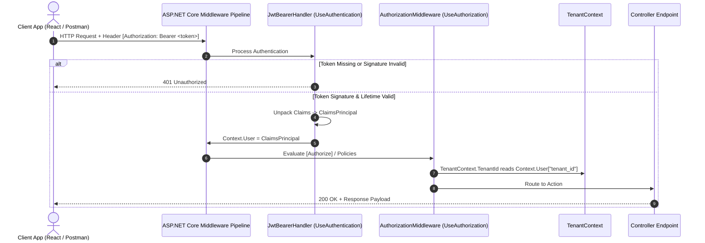

# 03. JWT Authentication & Security

## Objective & Authentication Architecture

**ResilienceX** employs stateless JSON Web Token (JWT) Bearer authentication for API request authorization. 

The primary objective is to cryptographically guarantee the identity of callers, verify their membership in a specific enterprise organization (`tenant_id`), and provide claims for subsequent role-based and multi-tenant access controls without requiring a database query on every HTTP request.

---

## 1. Cryptographic Token Generation & Claims Architecture

Tokens are generated internally by `AuthService.GenerateJwtToken` upon successful password or Google OAuth validation.

### Claims Layout
The JWT payload includes standard OIDC claims along with multi-tenant custom claims:

```csharp
var claims = new[]
{
    new Claim(JwtRegisteredClaimNames.Sub, user.Id.ToString()),
    new Claim(ClaimTypes.NameIdentifier, user.Id.ToString()),
    new Claim(JwtRegisteredClaimNames.Email, user.Email),
    new Claim(ClaimTypes.Email, user.Email),
    new Claim(ClaimTypes.Name, user.Username),
    new Claim("tenant_id", user.TenantId.ToString()), // Cryptographic Tenant Anchor
    new Claim(JwtRegisteredClaimNames.Jti, Guid.NewGuid().ToString())
};
```

| Claim | Key | Purpose |
| :--- | :--- | :--- |
| **Subject** | `sub` | Internal integer user identifier (`User.Id`). |
| **Email** | `email` | Authenticated user's verified corporate email address. |
| **Name** | `name` | Human-readable user display name or username. |
| **Tenant ID** | `tenant_id` | **Cryptographic Tenant Anchor**: Globally unique UUID representing the user's assigned organization tenant. |
| **JWT ID** | `jti` | Unique UUID minted per token to prevent token replay. |
| **Expiration** | `exp` | Unix timestamp indicating token expiry (default: 60 minutes). |

### Cryptographic Algorithm: HMAC-SHA256 (`HS256`)
Tokens are signed using a symmetric security key. To ensure defense against brute-force attacks, the application validates at startup that the key contains **at least 32 bytes (256 bits)**:

```csharp
var key = _configuration["Jwt:Key"]
    ?? throw new InvalidOperationException("JWT Key is not configured in application settings.");
if (Encoding.UTF8.GetByteCount(key) < 32)
{
    throw new InvalidOperationException("JWT Key must contain at least 32 bytes.");
}
```

---

## 2. ASP.NET Core Middleware Pipeline

Authentication and authorization are executed in the ASP.NET Core request pipeline inside `Program.cs`:



### Critical Middleware Pipeline Ordering
In `Program.cs`, middleware order is strictly enforced:

```csharp
app.UseHttpsRedirection();

// 1. Authenticate FIRST: Validates JWT signature and populates HttpContext.User
app.UseAuthentication();

// 2. Authorize SECOND: Evaluates [Authorize] rules against HttpContext.User
app.UseAuthorization();

app.MapControllers();
```

> [!WARNING]
> If `app.UseAuthentication()` is omitted or placed after `app.UseAuthorization()`, `HttpContext.User` will remain unauthenticated during policy evaluation, resulting in unexpected `401 Unauthorized` responses on protected endpoints.

---

## 3. Token Validation Parameters

The JWT Bearer authentication handler is configured in `Program.cs` with strict security parameters:

```csharp
builder.Services.AddAuthentication(options =>
{
    options.DefaultAuthenticateScheme = JwtBearerDefaults.AuthenticationScheme;
    options.DefaultChallengeScheme = JwtBearerDefaults.AuthenticationScheme;
})
.AddJwtBearer(options =>
{
    options.RequireHttpsMetadata = false; // Set to true in production SSL environments
    options.SaveToken = true;
    options.TokenValidationParameters = new TokenValidationParameters
    {
        ValidateIssuerSigningKey = true,
        IssuerSigningKey = new SymmetricSecurityKey(Encoding.UTF8.GetBytes(jwtKey)),
        ValidateIssuer = !string.IsNullOrWhiteSpace(builder.Configuration["Jwt:Issuer"]),
        ValidIssuer = builder.Configuration["Jwt:Issuer"],
        ValidateAudience = !string.IsNullOrWhiteSpace(builder.Configuration["Jwt:Audience"]),
        ValidAudience = builder.Configuration["Jwt:Audience"],
        ValidateLifetime = true,
        ClockSkew = TimeSpan.FromMinutes(1) // Mitigates clock drift across server nodes
    };
});
```

* **`ValidateIssuerSigningKey = true`**: Rejects any token not signed with ResilienceX's secret key.
* **`ValidateLifetime = true`**: Rejects expired tokens automatically.
* **`ClockSkew = TimeSpan.FromMinutes(1)`**: Limits acceptable clock skew to 60 seconds (down from the permissive default of 5 minutes).

---

## 4. OpenAPI / Swagger Bearer Authentication

Swashbuckle is configured to support HTTP Bearer authorization in interactive Swagger UI documentation:

```csharp
builder.Services.AddSwaggerGen(options =>
{
    options.SwaggerDoc("v1", new OpenApiInfo
    {
        Title = "ResilienceX API",
        Version = "v1",
        Description = "Cyber-Continuity platform for Third-Party Logistics (3PLs)"
    });

    var securityScheme = new OpenApiSecurityScheme
    {
        Name = "Authorization",
        Type = SecuritySchemeType.Http,
        Scheme = "bearer",
        BearerFormat = "JWT",
        In = ParameterLocation.Header,
        Description = "Enter JWT Bearer token."
    };

    options.AddSecurityDefinition("Bearer", securityScheme);

    options.AddSecurityRequirement(_ => new OpenApiSecurityRequirement
    {
        {
            new OpenApiSecuritySchemeReference("Bearer"),
            new List<string>()
        }
    });
});
```

Developers can authenticate in the Swagger UI by clicking the **Authorize** lock icon and pasting their JWT access token.

---

## 5. Security Best Practices & Secret Management

1. **Secret Storage**:
   * **Development**: Loaded from `appsettings.Development.json` or `.NET User Secrets` (`UserSecretsId` in `Backend.csproj`).
   * **Production**: Secret keys must be loaded via Environment Variables (`JWT__KEY`) or managed key vaults (Azure KeyVault, AWS Secrets Manager). Never commit production secrets to Git.
2. **Preventing Cross-Tenant Spoofing**:
   * The `tenant_id` claim is cryptographically immutable. A malicious client cannot alter their `tenant_id` without invalidating the cryptographic signature.
3. **Short-Lived Access Tokens**:
   * Default lifespan is configured to **60 minutes** (`Jwt:ExpiryMinutes = 60`).

---

## Implementation Status & Roadmap

| Feature | Status | Notes |
| :--- | :--- | :--- |
| JWT Generation (`HS256`) | **Complete** | Minimum 32-byte key enforced |
| Authentication Middleware | **Complete** | Correct pipeline placement before authorization |
| Swagger Bearer Integration | **Complete** | Fully interactive authorization dialog |
| Tenant ID Claim Anchor | **Complete** | Injected into all minted tokens |
| Refresh Token Flow | *Pending* | Recommended for seamless session extension |
| Role-Based Authorization Policies | *Pending* | Ready for custom role policies (`OperationsManager`, `SecurityAdmin`) |
