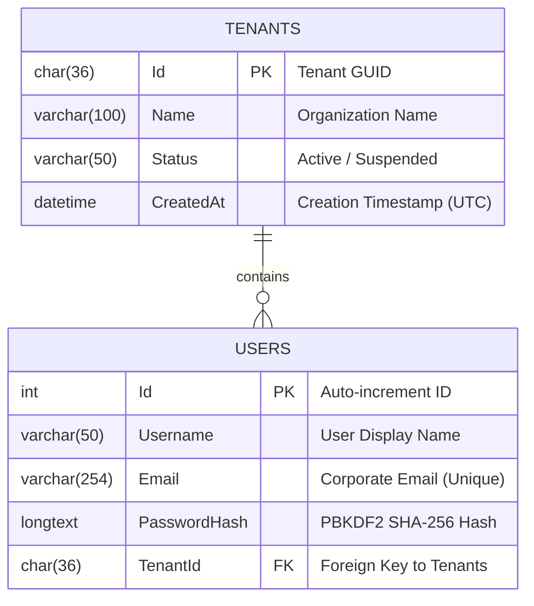

# 04. Infrastructure & Persistence

## Objective & Persistence Layer Architecture

The **Infrastructure & Persistence** layer (`Infrastructure/Persistence/`) manages all interactions with the relational MySQL database using **Entity Framework Core (EF Core 10)**.

The objective of Step 3 was to decouple persistence mapping and database configuration from the domain models, re-house the database context into `Infrastructure/Persistence/AppDbContext.cs`, extract fluent entity configurations (`IEntityTypeConfiguration<T>`), and organize database migrations while preserving the existing migration history intact.

---

## 1. AppDbContext Architecture

[AppDbContext.cs](file:///c:/Users/DELL/Downloads/UPS_Project/Backend/Backend/Infrastructure/Persistence/AppDbContext.cs) serves as the primary Unit of Work:

```csharp
namespace Backend.Infrastructure.Persistence
{
    public class AppDbContext : DbContext
    {
        private readonly ITenantContext? _tenantContext;

        public AppDbContext(
            DbContextOptions<AppDbContext> options,
            ITenantContext? tenantContext = null) : base(options)
        {
            _tenantContext = tenantContext;
        }

        public DbSet<Tenant> Tenants => Set<Tenant>();
        public DbSet<User> Users => Set<User>();

        protected override void OnModelCreating(ModelBuilder modelBuilder)
        {
            base.OnModelCreating(modelBuilder);

            // Automatically registers all IEntityTypeConfiguration classes in this assembly
            modelBuilder.ApplyConfigurationsFromAssembly(Assembly.GetExecutingAssembly());

            // Global Query Filter: restricts queries to the caller's tenant
            modelBuilder.Entity<User>().HasQueryFilter(u =>
                _tenantContext == null || !_tenantContext.HasTenant || u.TenantId == _tenantContext.TenantId!.Value);
        }
        ...
    }
}
```

### Architectural Highlights
1. **Dynamic Configuration Discovery**: `modelBuilder.ApplyConfigurationsFromAssembly` dynamically registers all entity configurations, eliminating hardcoded mappings in `OnModelCreating`.
2. **Optional Ambient Tenant Context**: `ITenantContext?` is injected into `AppDbContext`. If present and authenticated, global filters and mutation policies activate automatically.
3. **Safe Fallback for Migrations**: During design-time migration operations (CLI tools), `tenantContext` defaults to `null`, allowing EF Core tools to inspect the full schema unimpeded.

---

## 2. Fluent Entity Configurations

Entity-to-table mappings are isolated in [Infrastructure/Persistence/Configurations/](file:///c:/Users/DELL/Downloads/UPS_Project/Backend/Backend/Infrastructure/Persistence/Configurations/):

### A. User Entity Configuration (`UserConfiguration.cs`)
Maps the `User` domain model to the existing relational schema:

```csharp
namespace Backend.Infrastructure.Persistence.Configurations
{
    public class UserConfiguration : IEntityTypeConfiguration<User>
    {
        public void Configure(EntityTypeBuilder<User> builder)
        {
            builder.ToTable("Users");

            builder.HasKey(u => u.Id);

            builder.Property(u => u.Id)
                .ValueGeneratedOnAdd();

            builder.Property(u => u.Username)
                .IsRequired()
                .HasMaxLength(50);

            builder.Property(u => u.Email)
                .IsRequired()
                .HasMaxLength(254);

            builder.Property(u => u.PasswordHash)
                .IsRequired();

            builder.Property(u => u.TenantId)
                .IsRequired();

            builder.HasOne(u => u.Tenant)
                .WithMany(t => t.Users)
                .HasForeignKey(u => u.TenantId)
                .OnDelete(DeleteBehavior.Restrict);
        }
    }
}
```

### B. Tenant Entity Configuration (`TenantConfiguration.cs`)
Maps the new `Tenant` entity:

```csharp
namespace Backend.Infrastructure.Persistence.Configurations
{
    public class TenantConfiguration : IEntityTypeConfiguration<Tenant>
    {
        public void Configure(EntityTypeBuilder<Tenant> builder)
        {
            builder.ToTable("Tenants");

            builder.HasKey(t => t.Id);

            builder.Property(t => t.Name)
                .IsRequired()
                .HasMaxLength(100);

            builder.Property(t => t.Status)
                .IsRequired()
                .HasMaxLength(50);

            builder.Property(t => t.CreatedAt)
                .IsRequired();

            builder.HasMany(t => t.Users)
                .WithOne(u => u.Tenant)
                .HasForeignKey(u => u.TenantId)
                .OnDelete(DeleteBehavior.Restrict);
        }
    }
}
```

---

## 3. Entity-Relationship (ER) Diagram



### Referential Integrity Policy: `DeleteBehavior.Restrict`
Deleting a `Tenant` record is blocked if active `Users` are attached to that tenant. This prevents accidental cascading deletion of organizational users and their audit trail.

---

## 4. MySQL Provider & Assembly Registration

In `Program.cs`, the MySQL database provider is registered with explicit migration assembly discovery:

```csharp
builder.Services.AddDbContext<AppDbContext>(options =>
{
    options.UseMySQL(connectionstring, mysqlOptions =>
    {
        mysqlOptions.MigrationsAssembly(typeof(AppDbContext).Assembly.FullName);
    });
});
```

* **`MigrationsAssembly`**: Explicitly informs EF Core that database migrations reside inside the `Backend` assembly under `Backend.Infrastructure.Persistence.Migrations`.

---

## 5. Migration History Preservation

Historical migrations were moved from the root folder into [Infrastructure/Persistence/Migrations/](file:///c:/Users/DELL/Downloads/UPS_Project/Backend/Backend/Infrastructure/Persistence/Migrations/):

| Migration File | Migration Name | Applied Schema Changes |
| :--- | :--- | :--- |
| `20261118090658_InitialCreate.cs` | `InitialCreate` | Creates initial database and `Users` table with `varchar(10)` Username. |
| `20261118180142_IncreaseUsernameLength.cs` | `IncreaseUsernameLength` | Alters `Users.Username` from `varchar(10)` to `varchar(50)`. |
| `AppDBContextModelSnapshot.cs` | Snapshot | Current active compiled EF Core schema model. |

### Why Historical Migrations Must Never Be Deleted
In a production deployment, the database maintains a metadata table called `__EFMigrationsHistory`:
```sql
SELECT * FROM __EFMigrationsHistory;
```
If historical migration files are deleted or renamed in application code, EF Core loses the lineage between the database and the codebase. Subsequent calls to `dotnet ef database update` will fail with missing migration exceptions or attempt to recreate existing tables.

---

## Implementation Status & Roadmap

| Component | Status | Notes |
| :--- | :--- | :--- |
| `AppDbContext` relocation | **Complete** | Re-housed in `Infrastructure/Persistence/` |
| Fluent `IEntityTypeConfiguration` | **Complete** | `UserConfiguration` & `TenantConfiguration` |
| Migrations relocation | **Complete** | Relocated to `Persistence/Migrations/` |
| Database Migration for Tenants | *Pending Approval* | Model is prepared in C#; awaiting admin approval before executing database `ALTER TABLE` / `CREATE TABLE` scripts |
