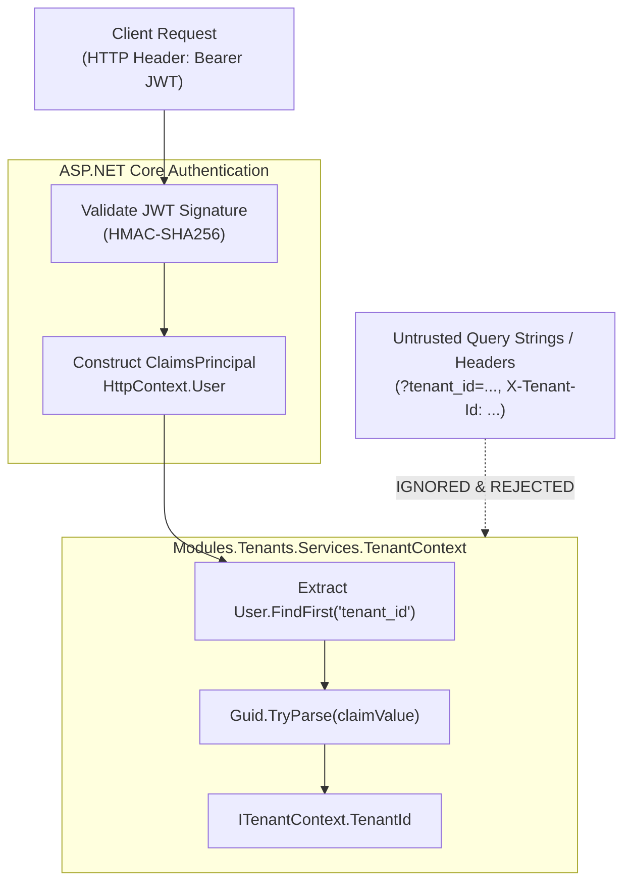
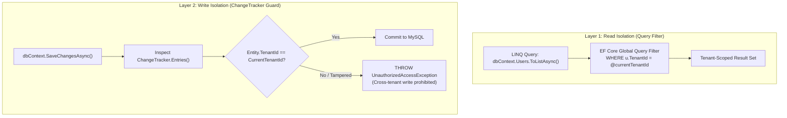

# 05. Multi-Tenancy Foundation

## Objective & Single-Tenant-per-User Model

In **ResilienceX**, 3PL logistics networks, freight terminals, and enterprise shippers operate on a shared infrastructure while requiring complete data partitioning.

The **Multi-Tenancy Foundation** (`Modules/Tenants`) enforces a **Single-Tenant-per-User** isolation model:
1. **Single Membership**: Each user belongs to exactly one Tenant (represented by a mandatory `User.TenantId` foreign key).
2. **Shared Organization**: Multiple users (e.g., dispatchers, terminal officers, managers) can belong to the same Tenant.
3. **Immutable Boundary**: A user cannot switch tenants or view records outside their assigned organization.
4. **Future Extensibility**: The architecture is designed so that future membership tables (e.g., `TenantUserMembership`) can be introduced for cross-organization auditing without breaking current single-tenant queries.

---

## 1. Zero-Trust Claims-Based Resolution (Anti-Spoofing)

Multi-tenant applications are vulnerable to **Parameter Tampering** when tenant IDs are read from HTTP headers (`X-Tenant-Id`) or query strings (`?tenant_id=...`). In such systems, a malicious user can tamper with the parameter to access another client's records.

ResilienceX eliminates this vulnerability using **Zero-Trust Claims-Based Resolution**:



### Implementation: [TenantContext.cs](file:///c:/Users/DELL/Downloads/UPS_Project/Backend/Backend/Modules/Tenants/Services/TenantContext.cs)
```csharp
namespace Backend.Modules.Tenants.Services
{
    public class TenantContext : ITenantContext
    {
        private readonly IHttpContextAccessor _httpContextAccessor;

        public TenantContext(IHttpContextAccessor httpContextAccessor)
        {
            _httpContextAccessor = httpContextAccessor;
        }

        public Guid? TenantId
        {
            get
            {
                var user = _httpContextAccessor.HttpContext?.User;
                if (user?.Identity?.IsAuthenticated != true)
                {
                    return null;
                }

                var tenantClaim = user.FindFirst("tenant_id")?.Value
                    ?? user.FindFirst("tenantId")?.Value
                    ?? user.FindFirst(ClaimTypes.GroupSid)?.Value;

                if (Guid.TryParse(tenantClaim, out var tenantId))
                {
                    return tenantId;
                }

                return null;
            }
        }

        public bool HasTenant => TenantId.HasValue;
    }
}
```

---

## 2. Defense in Depth: Read & Write Isolation

Tenant isolation is enforced directly inside [AppDbContext.cs](file:///c:/Users/DELL/Downloads/UPS_Project/Backend/Backend/Infrastructure/Persistence/AppDbContext.cs) through two complementary security layers:



### Layer 1: EF Core Global Query Filter (Read Isolation)
Configured on entity models implementing [ITenantEntity](file:///c:/Users/DELL/Downloads/UPS_Project/Backend/Backend/Common/Interfaces/ITenantEntity.cs):
```csharp
modelBuilder.Entity<User>().HasQueryFilter(u =>
    _tenantContext == null || !_tenantContext.HasTenant || u.TenantId == _tenantContext.TenantId!.Value);
```

#### Behavioral Rules:
1. **Authenticated Requests**: When an authenticated user queries `dbContext.Users`, EF Core automatically injects `WHERE u.TenantId = @tenantId` into the generated SQL query.
2. **Unauthenticated Requests**: During login (`AuthService.LoginAsync`), `_tenantContext.HasTenant` is `false`. The filter permits querying the user table by email across tenants to verify credentials.
3. **Explicit Override**: Administrative super-user tools can bypass filters using `dbContext.Users.IgnoreQueryFilters()` when explicit cross-tenant maintenance is required.

### Layer 2: Mutation Policy Enforcement (Write Isolation)
Overrides `SaveChanges` and `SaveChangesAsync` to inspect every added, modified, or deleted entity before sending SQL to MySQL:

```csharp
private void EnforceTenantPolicy()
{
    if (_tenantContext == null || !_tenantContext.HasTenant)
    {
        return;
    }

    var currentTenantId = _tenantContext.TenantId!.Value;

    foreach (var entry in ChangeTracker.Entries<ITenantEntity>())
    {
        if (entry.State == EntityState.Added)
        {
            // Auto-populate ambient tenant ID if unassigned
            if (entry.Entity.TenantId == Guid.Empty)
            {
                entry.Entity.TenantId = currentTenantId;
            }
            // Block cross-tenant injection
            else if (entry.Entity.TenantId != currentTenantId)
            {
                throw new UnauthorizedAccessException(
                    $"Cross-tenant write prohibited. Cannot create entity with TenantId '{entry.Entity.TenantId}' inside Tenant '{currentTenantId}'.");
            }
        }
        else if (entry.State == EntityState.Modified || entry.State == EntityState.Deleted)
        {
            // Block cross-tenant mutation
            if (entry.Entity.TenantId != currentTenantId)
            {
                throw new UnauthorizedAccessException(
                    $"Cross-tenant mutation prohibited. Cannot modify or delete entity belonging to Tenant '{entry.Entity.TenantId}' from Tenant '{currentTenantId}'.");
            }
        }
    }
}
```

---

## 3. Migration Strategy for Existing Users

A non-nullable foreign key column (`TenantId`) cannot be added to an existing table containing data without an explicit data population strategy. 

To adhere to the principle of **"Do not silently assign existing users to arbitrary tenants"**, the following phased SQL migration is proposed for administrative execution:

```sql
-- Step 1: Create the Tenants table
CREATE TABLE IF NOT EXISTS Tenants (
    Id CHAR(36) NOT NULL,
    Name VARCHAR(100) NOT NULL,
    Status VARCHAR(50) NOT NULL,
    CreatedAt DATETIME(6) NOT NULL,
    PRIMARY KEY (Id)
) ENGINE=InnoDB DEFAULT CHARSET=utf8mb4;

-- Step 2: Seed the verified enterprise workspace tenant
INSERT INTO Tenants (Id, Name, Status, CreatedAt)
VALUES (
    '11111111-1111-1111-1111-111111111111', 
    'Northwind Logistics', 
    'Active', 
    UTC_TIMESTAMP()
);

-- Step 3: Add nullable TenantId column
ALTER TABLE Users ADD COLUMN TenantId CHAR(36) NULL;

-- Step 4: Associate existing corporate accounts with Northwind Logistics
UPDATE Users 
SET TenantId = '11111111-1111-1111-1111-111111111111' 
WHERE TenantId IS NULL;

-- Step 5: Enforce NOT NULL and referential integrity
ALTER TABLE Users MODIFY COLUMN TenantId CHAR(36) NOT NULL;
ALTER TABLE Users ADD CONSTRAINT FK_Users_Tenants_TenantId 
    FOREIGN KEY (TenantId) REFERENCES Tenants(Id) ON DELETE RESTRICT;
```

---

## 4. Test Suite & Verification Results

A dedicated multi-tenant test suite was authored in [Modules/Tenants/Tests/TenantIsolationTests.cs](file:///c:/Users/DELL/Downloads/UPS_Project/Backend/Backend/Modules/Tenants/Tests/TenantIsolationTests.cs).

### Test Coverage Matrix
1. **Valid Claim Extraction**: Validates that `TenantContext` extracts `TenantId` correctly from authenticated claims.
2. **Unauthenticated Rejection**: Ensures unauthenticated users return `null` and `HasTenant == false`.
3. **Anti-Spoofing Check**: Verifies that `?tenant_id=...` query parameters and `X-Tenant-Id` headers are completely ignored.
4. **Malformed Claim Resilience**: Validates graceful handling of non-UUID string claims.
5. **Query Filter Verification**: Asserts that users belonging to Tenant B are filtered out when queried under Tenant A context, while remaining accessible during unauthenticated login lookup.
6. **Cross-Tenant Mutation Guard**: Verifies that attempting to insert, modify, or delete entities belonging to another tenant immediately throws `UnauthorizedAccessException`.

### Execution Command & Output
```bash
dotnet run --project Backend/Backend/Backend.csproj --no-build -- --run-tests
```

```text
=================================================
ResilienceX — Tenant Isolation Test Suite
=================================================
[PASS] TenantContext resolves TenantId from validated JWT claim
[PASS] TenantContext returns null for unauthenticated user
[PASS] TenantContext ignores untrusted query and header parameters
[PASS] TenantContext handles malformed GUID claims safely
[PASS] Query filter logic isolates tenant records and permits login lookup
[PASS] Cross-tenant mutation throws UnauthorizedAccessException
=================================================
Results: 6 passed, 0 failed.
=================================================
```

---

## Implementation Status & Roadmap

| Feature | Status | Notes |
| :--- | :--- | :--- |
| `Tenant` Domain Model & Config | **Complete** | Fluent configuration with `DeleteBehavior.Restrict` |
| `User.TenantId` Foreign Key | **Complete** | Configured in C# domain model |
| Claims-based `TenantContext` | **Complete** | Zero-trust parameter resolution |
| Global Query Filter | **Complete** | Injected in `AppDbContext` |
| Cross-Tenant Mutation Guards | **Complete** | `ChangeTracker` validation in `SaveChanges` |
| Isolation Test Suite | **Complete** | 6/6 tests passing |
| Database Migration Execution | *Pending Approval* | SQL migration script documented; awaiting user command before running |
| Multi-Tenant Business Modules | *Pending* | Future modules (Shipments, Systems) will implement `ITenantEntity` |
