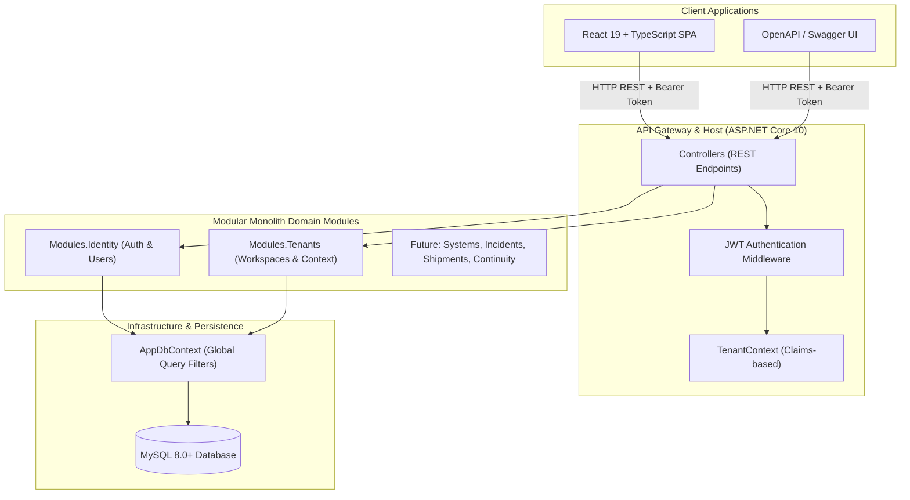

# ResilienceX — Technical Documentation

Welcome to the technical architecture and implementation documentation for **ResilienceX**, a production-oriented Cyber-Continuity and Operational Resilience Platform built for Third-Party Logistics (3PLs).

This documentation provides an architectural and engineering reference for the backend system, capturing the foundational design, module boundaries, persistence models, security policies, and multi-tenant isolation mechanisms.

---

## Documentation Index

The documentation is organized into focused architectural guides:

1. [**01. Modular Monolith Architecture**](file:///c:/Users/DELL/Downloads/UPS_Project/Documentation/01-Modular-Monolith-Architecture.md)  
   Core design philosophy, module boundaries, architectural patterns (Repository, Service, DI, DTO), and project layout.

2. [**02. Identity Module**](file:///c:/Users/DELL/Downloads/UPS_Project/Documentation/02-Identity-Module.md)  
   User domain models, authentication workflows (Registration, Password-based Login, Google OAuth 2.0), password hashing via PBKDF2, and DTO contracts.

3. [**03. JWT Authentication & Security**](file:///c:/Users/DELL/Downloads/UPS_Project/Documentation/03-JWT-Authentication-and-Security.md)  
   Cryptographic token generation, claims design (`sub`, `email`, `tenant_id`), ASP.NET Core authentication middleware pipeline, validation parameters, and Swagger Bearer authorization.

4. [**04. Infrastructure & Persistence**](file:///c:/Users/DELL/Downloads/UPS_Project/Documentation/04-Infrastructure-and-Persistence.md)  
   `AppDbContext` architecture, fluent entity configurations (`IEntityTypeConfiguration<T>`), MySQL EF Core relational mapping, and historical migration preservation.

5. [**05. Multi-Tenancy Foundation**](file:///c:/Users/DELL/Downloads/UPS_Project/Documentation/05-Multi-Tenancy-Foundation.md)  
   Single-tenant-per-user foundation, `Tenant` entity, claims-based `ITenantContext` resolution, EF Core Global Query Filters, cross-tenant mutation rejection, data migration strategy, and the test suite.

6. [**06. Systems Management Module**](file:///c:/Users/DELL/Downloads/UPS_Project/Documentation/06-Systems-Module.md)  
   Connected systems entity (`System.cs`), domain enumerations (`SystemType`, `SystemCriticality`, `SystemEnvironment`, `SystemLifecycleStatus`), and multi-tenant mapping principles.

---

## System Overview

ResilienceX is engineered to maintain business continuity during systemic IT outages, ransomware disruptions, or carrier integration failures across 3PL warehouse management (WMS), transportation management (TMS), and EDI gateways.

### High-Level Architecture



---

## Technology Stack

| Category | Component / Technology | Version / Specification |
| :--- | :--- | :--- |
| **Runtime & SDK** | Microsoft .NET SDK | `.NET 10.0` (C# 13) |
| **Web Framework** | ASP.NET Core Web API | `10.0` |
| **ORM & Data Access** | Entity Framework Core | `10.0.12` |
| **Database Provider** | MySql.EntityFrameworkCore | `10.0.12` |
| **Identity & Hashing** | Microsoft.AspNetCore.Identity | `IPasswordHasher<T>` (PBKDF2 SHA-256) |
| **Security Tokens** | Microsoft.AspNetCore.Authentication.JwtBearer | `10.0.12` |
| **External Auth** | Google.Apis.Auth | `1.68.0` |
| **API Documentation** | Swashbuckle.AspNetCore | `11.0.1` (OpenAPI v2 model) |
| **Frontend Client** | React + TypeScript + Vite | React 19, Vite 8, TypeScript 5.9 |

---

## Source Tree Directory Structure

```text
Backend/
├── Controllers/
│   └── AuthenticationController.cs              <- REST endpoints: /api/Authentication/*
├── Modules/
│   ├── Identity/
│   │   ├── Models/
│   │   │   └── User.cs                          <- User entity (ITenantEntity)
│   │   ├── DTOs/
│   │   │   ├── RegisterDTO.cs                   <- Registration payload
│   │   │   ├── LoginDTO.cs                      <- Login credentials
│   │   │   ├── LoginResponseDTO.cs              <- Token & profile response
│   │   │   ├── UserResponseDTO.cs               <- Public user representation
│   │   │   └── GoogleLoginDTO.cs                <- Google ID token credential
│   │   ├── Interfaces/
│   │   │   ├── IAuthService.cs                  <- Authentication orchestration contract
│   │   │   └── IUserRepository.cs               <- User persistence abstraction
│   │   ├── Services/
│   │   │   └── AuthService.cs                   <- Business logic, password verify, JWT issue
│   │   └── Repositories/
│   │       └── UserRepository.cs                <- EF Core user repository
│   └── Tenants/
│       ├── Models/
│       │   └── Tenant.cs                        <- Tenant root entity
│       ├── Interfaces/
│       │   ├── ITenantContext.cs                <- Ambient tenant accessor interface
│       │   └── ITenantRepository.cs             <- Tenant persistence contract
│       ├── Services/
│       │   └── TenantContext.cs                 <- Claims-based tenant resolver
│       ├── Repositories/
│       │   └── TenantRepository.cs              <- EF Core tenant repository
│       └── Tests/
│           └── TenantIsolationTests.cs          <- Tenant isolation test suite
│   └── Systems/
│       ├── Models/
│       │   └── System.cs                        <- Connected system entity (ITenantEntity)
│       └── Enums/
│           ├── SystemType.cs                    <- TMS, WMS, YMS, Telematics, EDI, ERP, Other
│           ├── SystemCriticality.cs             <- Low, Medium, High, Critical
│           ├── SystemEnvironment.cs             <- Development, Staging, Production
│           └── SystemLifecycleStatus.cs         <- Active, Inactive
├── Infrastructure/
│   ├── Persistence/
│   │   ├── AppDbContext.cs                      <- DbContext with Query Filters & Mutation Guards
│   │   ├── Configurations/
│   │   │   ├── TenantConfiguration.cs           <- Fluent EF mapping for Tenants table
│   │   │   └── UserConfiguration.cs             <- Fluent EF mapping for Users table
│   │   └── Migrations/
│   │       ├── 20261118090658_InitialCreate.cs
│   │       ├── 20261118180142_IncreaseUsernameLength.cs
│   │       └── AppDBContextModelSnapshot.cs
│   └── Security/
│       └── JwtOptions.cs                        <- Strongly-typed JWT options
├── Common/
│   ├── Interfaces/
│   │   └── ITenantEntity.cs                     <- Marker interface for tenant-scoped models
│   └── Responses/
│       └── ResponseDTO.cs                       <- Standardized JSON response envelope
├── Program.cs                                   <- Composition root, pipeline, services
└── Backend.csproj                               <- Project build definitions & packages
```

---

## Architectural Principles

1. **Modular Monolith**: Organized by business capability into explicit modules (`Modules/Identity`, `Modules/Tenants`), deployed together as a single executable for operational simplicity.
2. **Strict Inversion of Control**: High-level business logic depends only on interfaces (`IUserRepository`, `ITenantRepository`, `ITenantContext`), while infrastructure and persistence components implement those interfaces.
3. **Defense in Depth Multi-Tenancy**: Tenant isolation is enforced at the database context level via EF Core Global Query Filters and `SaveChanges` mutation guards, eliminating the risk of developer omission in controller actions.
4. **Zero-Trust Parameter Resolution**: Multi-tenant context is resolved strictly from cryptographically signed JWT tokens, preventing parameter spoofing and cross-tenant privilege escalation.
